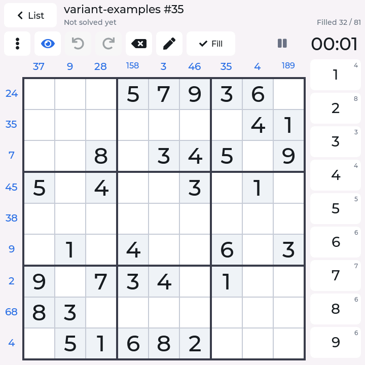
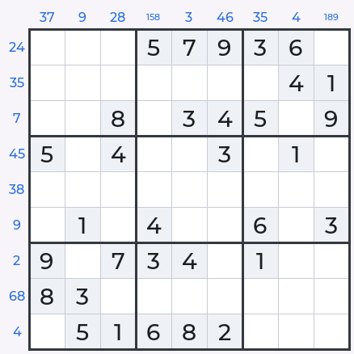

# Outside Sudoku

[← All variants](README.md) · [Puzzles](../features-puzzles.md) · [How to play](../how-to-play.md)

## The rules

[Classic](classic.md) rules, and **clues** left of some rows and above some columns. A clue lists **1 to 3 digits that are among the first three cells** from there (the cells of that row or column in the first box), in any order. With 5, 8, 2 as the first three, a clue of **25** fits; the third cell can be anything else. A line without a clue has no such rule.

Since a row holds each digit once, a clue's digits are **nowhere else in that row** (or column).

## On the board

- The clues are in blue in a margin left of the rows and above the columns, their digits side by side; a line without a clue has none.
- The first three cells of a line turn red when fewer of them are empty than the clue's digits still missing.
- The grader and hints keep a clue's digits out of the rest of its row or column from the start, and narrow the first three cells to what leaves room for the clue: "The clue of column 4 says 1, 5, 8 are among its first three cells, so row 2, column 4 can only be 8".
- **Puzzles → ⋮ → New puzzle → Clues → Outside**: about 85 % of the lines have a clue (Hard and Expert: about 70 %), each with 1 to 3 of its first three digits.

## How to solve it

- **The rest of the line is out:** a clue's digits can't be anywhere past the first three cells of its row or column.
- **A three-digit clue fills the cells:** the three cells hold exactly those digits, in some order, like a little box.
- **Two clues meet in a corner box:** the first three cells of row 1 and of column 1 share the top-left cell; a digit in both clues is a strong hint it sits there.
- **Count the room:** with one empty cell left among the three and a clue digit still missing, that digit goes in it.

## Worked example

**variant-examples #35**, Outside Sudoku Easy (see [Classic](classic.md#worked-example-the-whole-puzzle) for how to import the examples; cells are written r*row*c*column*). The clues are in the screenshot; from the left, row 3's is **7**; from the top, column 1's is **37** and column 4's **158**.

**Step 1: r2c4, column 4 (clue 158).** Row 2 has 1 and 4; column 4 has 3, 5 and 6; box 2 has 7 and 9: that leaves 2 and 8. Column 4's first three cells must hold 1, 5 and 8. r1c4 is the 5, so 1 and 8 go in r2c4 and r3c4, and row 2 already has its 1. **r2c4 = 8**.

**Step 2: r3c8, row 3 (clue 7).** Row 3 has 3, 4, 5, 8 and 9; column 8 has 1 and 6: that leaves 2 and 7. Row 3's clue puts its 7 among its first three cells, so it can't be in r3c8. **r3c8 = 2**.

**Step 3: r6c1, column 1 (clue 37).** Row 6 has 1, 3, 4 and 6; column 1 has 5, 8 and 9: that leaves 2 and 7. Column 1's clue puts its 7 among its first three cells (rows 1 to 3), so not in row 6. **r6c1 = 2**.

## The whole puzzle, step by step

<!-- walkthrough -->
<!-- Written by tools/walkthrough.py outside-sudoku: edit the script, not this part. -->

The whole puzzle, from the start to the last cell: 49 steps, each one a single (one place left for a digit, or one digit left for a cell), taken in the order a box's single comes first, so not quite the order of the worked example above. Each step has a page of its own, with **Previous** and **Next**: pick its number below. In each picture, the unit the step looks at is tinted yellow (for a cell with one digit left: its row, column and box), the new digit is on green, the digits that rule cells out have an **orange ring**, and the empty cells they rule out a **red cross**. Givens are on grey, digits from earlier steps in blue.

| [1](outside-sudoku/step-01.md) | [2](outside-sudoku/step-02.md) | [3](outside-sudoku/step-03.md) | [4](outside-sudoku/step-04.md) | [5](outside-sudoku/step-05.md) | [6](outside-sudoku/step-06.md) | [7](outside-sudoku/step-07.md) | [8](outside-sudoku/step-08.md) | [9](outside-sudoku/step-09.md) | [10](outside-sudoku/step-10.md) |
|:-:|:-:|:-:|:-:|:-:|:-:|:-:|:-:|:-:|:-:|
| [11](outside-sudoku/step-11.md) | [12](outside-sudoku/step-12.md) | [13](outside-sudoku/step-13.md) | [14](outside-sudoku/step-14.md) | [15](outside-sudoku/step-15.md) | [16](outside-sudoku/step-16.md) | [17](outside-sudoku/step-17.md) | [18](outside-sudoku/step-18.md) | [19](outside-sudoku/step-19.md) | [20](outside-sudoku/step-20.md) |
| [21](outside-sudoku/step-21.md) | [22](outside-sudoku/step-22.md) | [23](outside-sudoku/step-23.md) | [24](outside-sudoku/step-24.md) | [25](outside-sudoku/step-25.md) | [26](outside-sudoku/step-26.md) | [27](outside-sudoku/step-27.md) | [28](outside-sudoku/step-28.md) | [29](outside-sudoku/step-29.md) | [30](outside-sudoku/step-30.md) |
| [31](outside-sudoku/step-31.md) | [32](outside-sudoku/step-32.md) | [33](outside-sudoku/step-33.md) | [34](outside-sudoku/step-34.md) | [35](outside-sudoku/step-35.md) | [36](outside-sudoku/step-36.md) | [37](outside-sudoku/step-37.md) | [38](outside-sudoku/step-38.md) | [39](outside-sudoku/step-39.md) | [40](outside-sudoku/step-40.md) |
| [41](outside-sudoku/step-41.md) | [42](outside-sudoku/step-42.md) | [43](outside-sudoku/step-43.md) | [44](outside-sudoku/step-44.md) | [45](outside-sudoku/step-45.md) | [46](outside-sudoku/step-46.md) | [47](outside-sudoku/step-47.md) | [48](outside-sudoku/step-48.md) | [49](outside-sudoku/step-49.md) |  |

Solved.

<!-- /walkthrough -->
