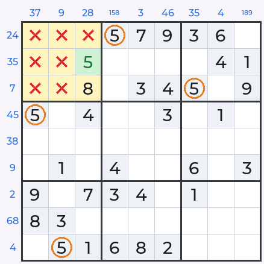

<!-- Written by tools/walkthrough.py outside-sudoku: edit the script, not this page. -->
# Outside Sudoku, step 1: the 5 in box 1

**Step 1 of 49** · [← The start](../outside-sudoku.md#the-whole-puzzle-step-by-step) · [All steps](../outside-sudoku.md#the-whole-puzzle-step-by-step) · [Step 2 →](step-02.md)

Box 1 needs a 5. r1c1, r1c2 and r1c3: row 1 has one (r1c4). r2c1: column 1 has one (r4c1). r2c2: column 2 has one (r9c2). r3c1 and r3c2: row 3 has one (r3c7). Only **r2c3** is left: **r2c3 = 5**.

**Step 1 of 49** · [← The start](../outside-sudoku.md#the-whole-puzzle-step-by-step) · [All steps](../outside-sudoku.md#the-whole-puzzle-step-by-step) · [Step 2 →](step-02.md)
