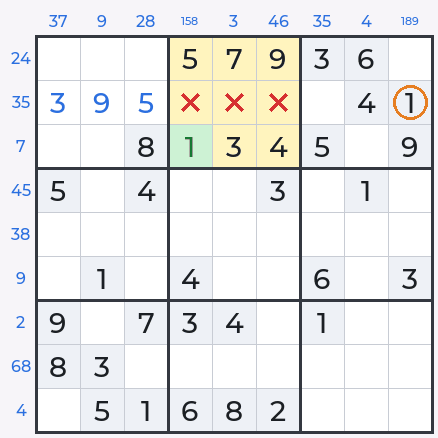

<!-- Written by tools/walkthrough.py outside-sudoku: edit the script, not this page. -->
# Outside Sudoku, step 4: the 1 in box 2

**Step 4 of 49** · [← Step 3](step-03.md) · [All steps](../outside-sudoku.md#the-whole-puzzle-step-by-step) · [Step 5 →](step-05.md)

Box 2 needs a 1. r2c4, r2c5 and r2c6: row 2 has one (r2c9). Only **r3c4** is left: **r3c4 = 1**.

**Step 4 of 49** · [← Step 3](step-03.md) · [All steps](../outside-sudoku.md#the-whole-puzzle-step-by-step) · [Step 5 →](step-05.md)
