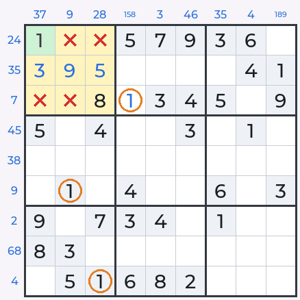

<!-- Written by tools/walkthrough.py outside-sudoku: edit the script, not this page. -->
# Outside Sudoku, step 5: the 1 in box 1

**Step 5 of 49** · [← Step 4](step-04.md) · [All steps](../outside-sudoku.md#the-whole-puzzle-step-by-step) · [Step 6 →](step-06.md)

Box 1 needs a 1. r1c2: column 2 has one (r6c2). r1c3: column 3 has one (r9c3). r3c1 and r3c2: row 3 has one (r3c4). Only **r1c1** is left: **r1c1 = 1**.

**Step 5 of 49** · [← Step 4](step-04.md) · [All steps](../outside-sudoku.md#the-whole-puzzle-step-by-step) · [Step 6 →](step-06.md)
