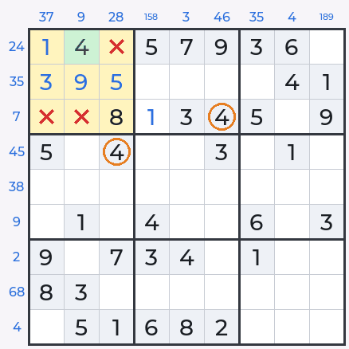

<!-- Written by tools/walkthrough.py outside-sudoku: edit the script, not this page. -->
# Outside Sudoku, step 6: the 4 in box 1

**Step 6 of 49** · [← Step 5](step-05.md) · [All steps](../outside-sudoku.md#the-whole-puzzle-step-by-step) · [Step 7 →](step-07.md)

Box 1 needs a 4. r1c3: column 3 has one (r4c3). r3c1 and r3c2: row 3 has one (r3c6). Only **r1c2** is left: **r1c2 = 4**.

**Step 6 of 49** · [← Step 5](step-05.md) · [All steps](../outside-sudoku.md#the-whole-puzzle-step-by-step) · [Step 7 →](step-07.md)
