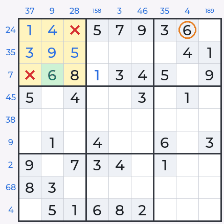

<!-- Written by tools/walkthrough.py outside-sudoku: edit the script, not this page. -->
# Outside Sudoku, step 7: the 6 in box 1

**Step 7 of 49** · [← Step 6](step-06.md) · [All steps](../outside-sudoku.md#the-whole-puzzle-step-by-step) · [Step 8 →](step-08.md)

Box 1 needs a 6. r1c3: row 1 has one (r1c8). r3c1: Column 1's clue puts 3 and 7 among its first three cells: with a 6 here, there'd be no room left for 7. Only **r3c2** is left: **r3c2 = 6**.

**Step 7 of 49** · [← Step 6](step-06.md) · [All steps](../outside-sudoku.md#the-whole-puzzle-step-by-step) · [Step 8 →](step-08.md)
