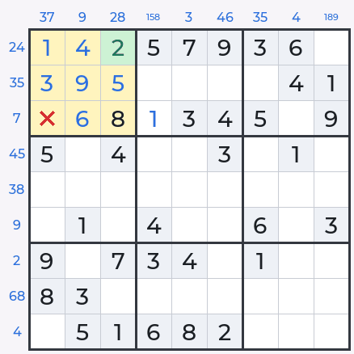

<!-- Written by tools/walkthrough.py outside-sudoku: edit the script, not this page. -->
# Outside Sudoku, step 8: the 2 in box 1

**Step 8 of 49** · [← Step 7](step-07.md) · [All steps](../outside-sudoku.md#the-whole-puzzle-step-by-step) · [Step 9 →](step-09.md)

Box 1 needs a 2. r3c1: Row 3's clue puts 7 among its first three cells: with a 2 here, there'd be no room left for 7. Only **r1c3** is left: **r1c3 = 2**.

**Step 8 of 49** · [← Step 7](step-07.md) · [All steps](../outside-sudoku.md#the-whole-puzzle-step-by-step) · [Step 9 →](step-09.md)
