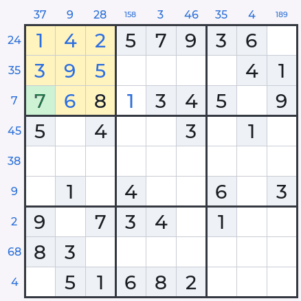

<!-- Written by tools/walkthrough.py outside-sudoku: edit the script, not this page. -->
# Outside Sudoku, step 9: the 7 in box 1

**Step 9 of 49** · [← Step 8](step-08.md) · [All steps](../outside-sudoku.md#the-whole-puzzle-step-by-step) · [Step 10 →](step-10.md)

Box 1 needs a 7, and r3c1 is its last empty cell: **r3c1 = 7**.

**Step 9 of 49** · [← Step 8](step-08.md) · [All steps](../outside-sudoku.md#the-whole-puzzle-step-by-step) · [Step 10 →](step-10.md)
