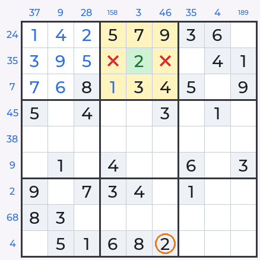

<!-- Written by tools/walkthrough.py outside-sudoku: edit the script, not this page. -->
# Outside Sudoku, step 10: the 2 in box 2

**Step 10 of 49** · [← Step 9](step-09.md) · [All steps](../outside-sudoku.md#the-whole-puzzle-step-by-step) · [Step 11 →](step-11.md)

Box 2 needs a 2. r2c6: column 6 has one (r9c6). r2c4: Column 4's clue puts 1, 5 and 8 among its first three cells: with a 2 here, there'd be no room left for 8. Only **r2c5** is left: **r2c5 = 2**.

**Step 10 of 49** · [← Step 9](step-09.md) · [All steps](../outside-sudoku.md#the-whole-puzzle-step-by-step) · [Step 11 →](step-11.md)
