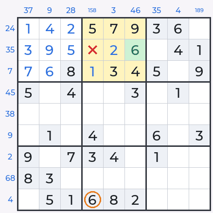

<!-- Written by tools/walkthrough.py outside-sudoku: edit the script, not this page. -->
# Outside Sudoku, step 11: the 6 in box 2

**Step 11 of 49** · [← Step 10](step-10.md) · [All steps](../outside-sudoku.md#the-whole-puzzle-step-by-step) · [Step 12 →](step-12.md)

Box 2 needs a 6. r2c4: column 4 has one (r9c4). Only **r2c6** is left: **r2c6 = 6**.

**Step 11 of 49** · [← Step 10](step-10.md) · [All steps](../outside-sudoku.md#the-whole-puzzle-step-by-step) · [Step 12 →](step-12.md)
