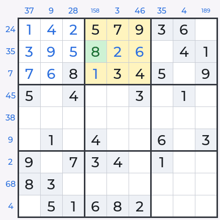

<!-- Written by tools/walkthrough.py outside-sudoku: edit the script, not this page. -->
# Outside Sudoku, step 12: the 8 in box 2

**Step 12 of 49** · [← Step 11](step-11.md) · [All steps](../outside-sudoku.md#the-whole-puzzle-step-by-step) · [Step 13 →](step-13.md)

Box 2 needs an 8, and r2c4 is its last empty cell: **r2c4 = 8**.

**Step 12 of 49** · [← Step 11](step-11.md) · [All steps](../outside-sudoku.md#the-whole-puzzle-step-by-step) · [Step 13 →](step-13.md)
