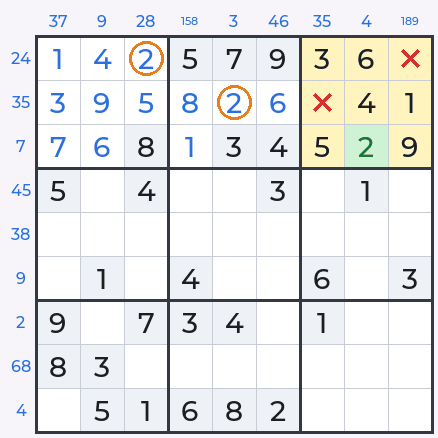

<!-- Written by tools/walkthrough.py outside-sudoku: edit the script, not this page. -->
# Outside Sudoku, step 13: the 2 in box 3

**Step 13 of 49** · [← Step 12](step-12.md) · [All steps](../outside-sudoku.md#the-whole-puzzle-step-by-step) · [Step 14 →](step-14.md)

Box 3 needs a 2. r1c9: row 1 has one (r1c3). r2c7: row 2 has one (r2c5). Only **r3c8** is left: **r3c8 = 2**.

**Step 13 of 49** · [← Step 12](step-12.md) · [All steps](../outside-sudoku.md#the-whole-puzzle-step-by-step) · [Step 14 →](step-14.md)
