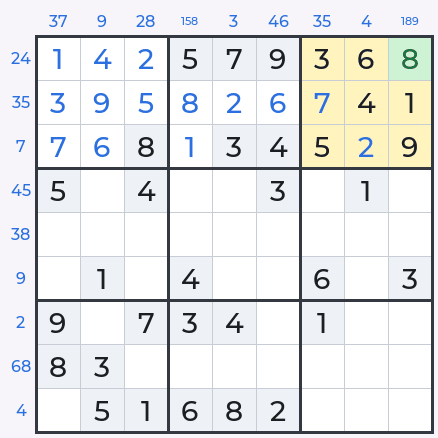

<!-- Written by tools/walkthrough.py outside-sudoku: edit the script, not this page. -->
# Outside Sudoku, step 15: the 8 in box 3

**Step 15 of 49** · [← Step 14](step-14.md) · [All steps](../outside-sudoku.md#the-whole-puzzle-step-by-step) · [Step 16 →](step-16.md)

Box 3 needs an 8, and r1c9 is its last empty cell: **r1c9 = 8**.

**Step 15 of 49** · [← Step 14](step-14.md) · [All steps](../outside-sudoku.md#the-whole-puzzle-step-by-step) · [Step 16 →](step-16.md)
