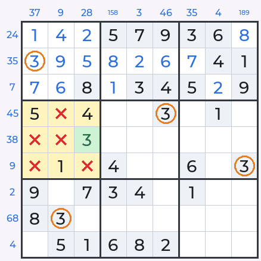

<!-- Written by tools/walkthrough.py outside-sudoku: edit the script, not this page. -->
# Outside Sudoku, step 16: the 3 in box 4

**Step 16 of 49** · [← Step 15](step-15.md) · [All steps](../outside-sudoku.md#the-whole-puzzle-step-by-step) · [Step 17 →](step-17.md)

Box 4 needs a 3. r4c2: row 4 has one (r4c6). r5c1: column 1 has one (r2c1). r5c2: column 2 has one (r8c2). r6c1 and r6c3: row 6 has one (r6c9). Only **r5c3** is left: **r5c3 = 3**.

**Step 16 of 49** · [← Step 15](step-15.md) · [All steps](../outside-sudoku.md#the-whole-puzzle-step-by-step) · [Step 17 →](step-17.md)
