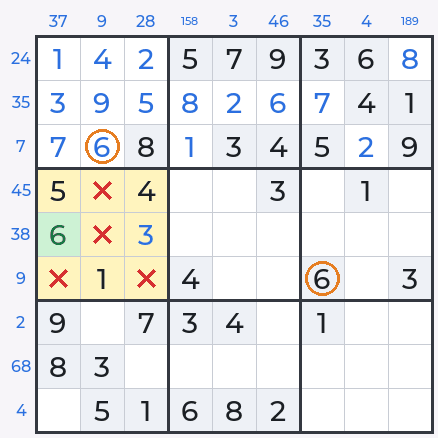

<!-- Written by tools/walkthrough.py outside-sudoku: edit the script, not this page. -->
# Outside Sudoku, step 17: the 6 in box 4

**Step 17 of 49** · [← Step 16](step-16.md) · [All steps](../outside-sudoku.md#the-whole-puzzle-step-by-step) · [Step 18 →](step-18.md)

Box 4 needs a 6. r4c2 and r5c2: column 2 has one (r3c2). r6c1 and r6c3: row 6 has one (r6c7). Only **r5c1** is left: **r5c1 = 6**.

**Step 17 of 49** · [← Step 16](step-16.md) · [All steps](../outside-sudoku.md#the-whole-puzzle-step-by-step) · [Step 18 →](step-18.md)
