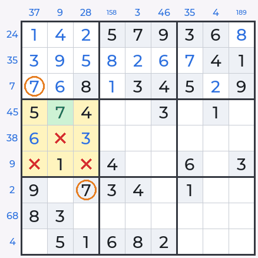

<!-- Written by tools/walkthrough.py outside-sudoku: edit the script, not this page. -->
# Outside Sudoku, step 18: the 7 in box 4

**Step 18 of 49** · [← Step 17](step-17.md) · [All steps](../outside-sudoku.md#the-whole-puzzle-step-by-step) · [Step 19 →](step-19.md)

Box 4 needs a 7. r6c1: column 1 has one (r3c1). r6c3: column 3 has one (r7c3). r5c2: Row 5's clue puts 3 and 8 among its first three cells: with a 7 here, there'd be no room left for 8. Only **r4c2** is left: **r4c2 = 7**.

**Step 18 of 49** · [← Step 17](step-17.md) · [All steps](../outside-sudoku.md#the-whole-puzzle-step-by-step) · [Step 19 →](step-19.md)
