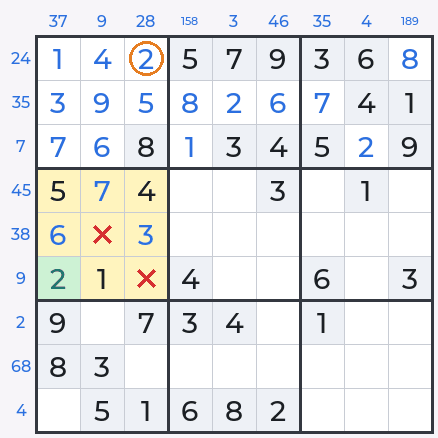

<!-- Written by tools/walkthrough.py outside-sudoku: edit the script, not this page. -->
# Outside Sudoku, step 19: the 2 in box 4

**Step 19 of 49** · [← Step 18](step-18.md) · [All steps](../outside-sudoku.md#the-whole-puzzle-step-by-step) · [Step 20 →](step-20.md)

Box 4 needs a 2. r6c3: column 3 has one (r1c3). r5c2: Row 5's clue puts 3 and 8 among its first three cells: with a 2 here, there'd be no room left for 8. Only **r6c1** is left: **r6c1 = 2**.

**Step 19 of 49** · [← Step 18](step-18.md) · [All steps](../outside-sudoku.md#the-whole-puzzle-step-by-step) · [Step 20 →](step-20.md)
