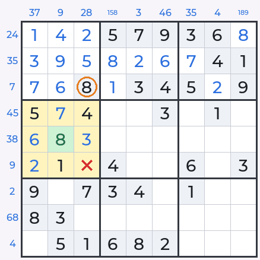

<!-- Written by tools/walkthrough.py outside-sudoku: edit the script, not this page. -->
# Outside Sudoku, step 20: the 8 in box 4

**Step 20 of 49** · [← Step 19](step-19.md) · [All steps](../outside-sudoku.md#the-whole-puzzle-step-by-step) · [Step 21 →](step-21.md)

Box 4 needs an 8. r6c3: column 3 has one (r3c3). Only **r5c2** is left: **r5c2 = 8**.

**Step 20 of 49** · [← Step 19](step-19.md) · [All steps](../outside-sudoku.md#the-whole-puzzle-step-by-step) · [Step 21 →](step-21.md)
