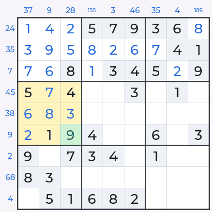

<!-- Written by tools/walkthrough.py outside-sudoku: edit the script, not this page. -->
# Outside Sudoku, step 21: the 9 in box 4

**Step 21 of 49** · [← Step 20](step-20.md) · [All steps](../outside-sudoku.md#the-whole-puzzle-step-by-step) · [Step 22 →](step-22.md)

Box 4 needs a 9, and r6c3 is its last empty cell: **r6c3 = 9**.

**Step 21 of 49** · [← Step 20](step-20.md) · [All steps](../outside-sudoku.md#the-whole-puzzle-step-by-step) · [Step 22 →](step-22.md)
