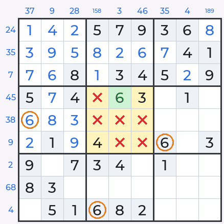

<!-- Written by tools/walkthrough.py outside-sudoku: edit the script, not this page. -->
# Outside Sudoku, step 22: the 6 in box 5

**Step 22 of 49** · [← Step 21](step-21.md) · [All steps](../outside-sudoku.md#the-whole-puzzle-step-by-step) · [Step 23 →](step-23.md)

Box 5 needs a 6. r4c4: column 4 has one (r9c4). r5c4, r5c5 and r5c6: row 5 has one (r5c1). r6c5 and r6c6: row 6 has one (r6c7). Only **r4c5** is left: **r4c5 = 6**.

**Step 22 of 49** · [← Step 21](step-21.md) · [All steps](../outside-sudoku.md#the-whole-puzzle-step-by-step) · [Step 23 →](step-23.md)
