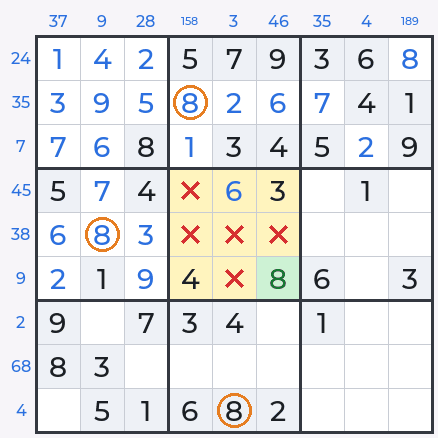

<!-- Written by tools/walkthrough.py outside-sudoku: edit the script, not this page. -->
# Outside Sudoku, step 23: the 8 in box 5

**Step 23 of 49** · [← Step 22](step-22.md) · [All steps](../outside-sudoku.md#the-whole-puzzle-step-by-step) · [Step 24 →](step-24.md)

Box 5 needs an 8. r4c4: column 4 has one (r2c4). r5c4, r5c5 and r5c6: row 5 has one (r5c2). r6c5: column 5 has one (r9c5). Only **r6c6** is left: **r6c6 = 8**.

**Step 23 of 49** · [← Step 22](step-22.md) · [All steps](../outside-sudoku.md#the-whole-puzzle-step-by-step) · [Step 24 →](step-24.md)
