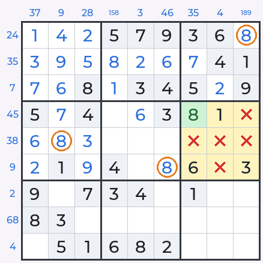

<!-- Written by tools/walkthrough.py outside-sudoku: edit the script, not this page. -->
# Outside Sudoku, step 24: the 8 in box 6

**Step 24 of 49** · [← Step 23](step-23.md) · [All steps](../outside-sudoku.md#the-whole-puzzle-step-by-step) · [Step 25 →](step-25.md)

Box 6 needs an 8. r4c9: column 9 has one (r1c9). r5c7, r5c8 and r5c9: row 5 has one (r5c2). r6c8: row 6 has one (r6c6). Only **r4c7** is left: **r4c7 = 8**.

**Step 24 of 49** · [← Step 23](step-23.md) · [All steps](../outside-sudoku.md#the-whole-puzzle-step-by-step) · [Step 25 →](step-25.md)
