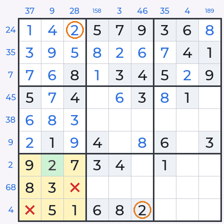

<!-- Written by tools/walkthrough.py outside-sudoku: edit the script, not this page. -->
# Outside Sudoku, step 25: the 2 in box 7

**Step 25 of 49** · [← Step 24](step-24.md) · [All steps](../outside-sudoku.md#the-whole-puzzle-step-by-step) · [Step 26 →](step-26.md)

Box 7 needs a 2. r8c3: column 3 has one (r1c3). r9c1: row 9 has one (r9c6). Only **r7c2** is left: **r7c2 = 2**.

**Step 25 of 49** · [← Step 24](step-24.md) · [All steps](../outside-sudoku.md#the-whole-puzzle-step-by-step) · [Step 26 →](step-26.md)
