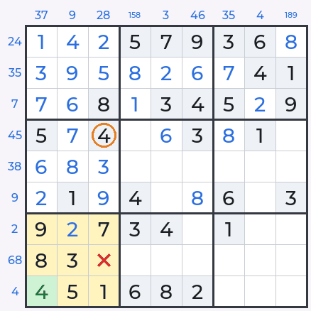

<!-- Written by tools/walkthrough.py outside-sudoku: edit the script, not this page. -->
# Outside Sudoku, step 26: the 4 in box 7

**Step 26 of 49** · [← Step 25](step-25.md) · [All steps](../outside-sudoku.md#the-whole-puzzle-step-by-step) · [Step 27 →](step-27.md)

Box 7 needs a 4. r8c3: column 3 has one (r4c3). Only **r9c1** is left: **r9c1 = 4**.

**Step 26 of 49** · [← Step 25](step-25.md) · [All steps](../outside-sudoku.md#the-whole-puzzle-step-by-step) · [Step 27 →](step-27.md)
