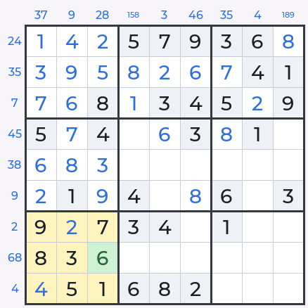

<!-- Written by tools/walkthrough.py outside-sudoku: edit the script, not this page. -->
# Outside Sudoku, step 27: the 6 in box 7

**Step 27 of 49** · [← Step 26](step-26.md) · [All steps](../outside-sudoku.md#the-whole-puzzle-step-by-step) · [Step 28 →](step-28.md)

Box 7 needs a 6, and r8c3 is its last empty cell: **r8c3 = 6**.

**Step 27 of 49** · [← Step 26](step-26.md) · [All steps](../outside-sudoku.md#the-whole-puzzle-step-by-step) · [Step 28 →](step-28.md)
