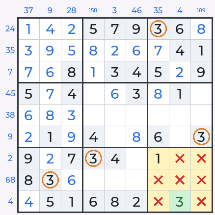

<!-- Written by tools/walkthrough.py outside-sudoku: edit the script, not this page. -->
# Outside Sudoku, step 28: the 3 in box 9

**Step 28 of 49** · [← Step 27](step-27.md) · [All steps](../outside-sudoku.md#the-whole-puzzle-step-by-step) · [Step 29 →](step-29.md)

Box 9 needs a 3. r7c8 and r7c9: row 7 has one (r7c4). r8c7, r8c8 and r8c9: row 8 has one (r8c2). r9c7: column 7 has one (r1c7). r9c9: column 9 has one (r6c9). Only **r9c8** is left: **r9c8 = 3**.

**Step 28 of 49** · [← Step 27](step-27.md) · [All steps](../outside-sudoku.md#the-whole-puzzle-step-by-step) · [Step 29 →](step-29.md)
