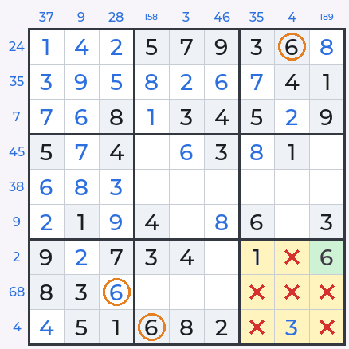

<!-- Written by tools/walkthrough.py outside-sudoku: edit the script, not this page. -->
# Outside Sudoku, step 29: the 6 in box 9

**Step 29 of 49** · [← Step 28](step-28.md) · [All steps](../outside-sudoku.md#the-whole-puzzle-step-by-step) · [Step 30 →](step-30.md)

Box 9 needs a 6. r7c8: column 8 has one (r1c8). r8c7, r8c8 and r8c9: row 8 has one (r8c3). r9c7 and r9c9: row 9 has one (r9c4). Only **r7c9** is left: **r7c9 = 6**.

**Step 29 of 49** · [← Step 28](step-28.md) · [All steps](../outside-sudoku.md#the-whole-puzzle-step-by-step) · [Step 30 →](step-30.md)
