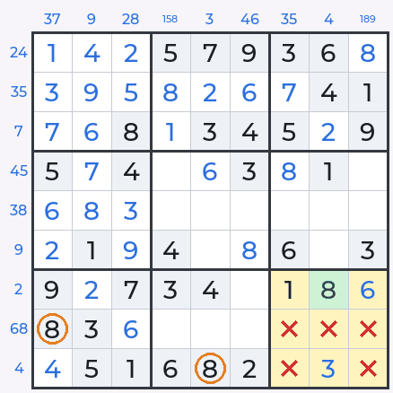

<!-- Written by tools/walkthrough.py outside-sudoku: edit the script, not this page. -->
# Outside Sudoku, step 30: the 8 in box 9

**Step 30 of 49** · [← Step 29](step-29.md) · [All steps](../outside-sudoku.md#the-whole-puzzle-step-by-step) · [Step 31 →](step-31.md)

Box 9 needs an 8. r8c7, r8c8 and r8c9: row 8 has one (r8c1). r9c7 and r9c9: row 9 has one (r9c5). Only **r7c8** is left: **r7c8 = 8**.

**Step 30 of 49** · [← Step 29](step-29.md) · [All steps](../outside-sudoku.md#the-whole-puzzle-step-by-step) · [Step 31 →](step-31.md)
