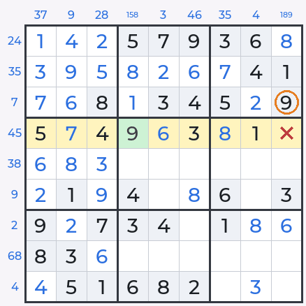

<!-- Written by tools/walkthrough.py outside-sudoku: edit the script, not this page. -->
# Outside Sudoku, step 31: the 9 in row 4

**Step 31 of 49** · [← Step 30](step-30.md) · [All steps](../outside-sudoku.md#the-whole-puzzle-step-by-step) · [Step 32 →](step-32.md)

Row 4 needs a 9. r4c9: column 9 has one (r3c9). Only **r4c4** is left: **r4c4 = 9**.

**Step 31 of 49** · [← Step 30](step-30.md) · [All steps](../outside-sudoku.md#the-whole-puzzle-step-by-step) · [Step 32 →](step-32.md)
