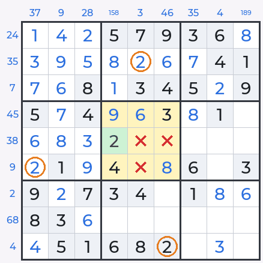

<!-- Written by tools/walkthrough.py outside-sudoku: edit the script, not this page. -->
# Outside Sudoku, step 32: the 2 in box 5

**Step 32 of 49** · [← Step 31](step-31.md) · [All steps](../outside-sudoku.md#the-whole-puzzle-step-by-step) · [Step 33 →](step-33.md)

Box 5 needs a 2. r5c5: column 5 has one (r2c5). r5c6: column 6 has one (r9c6). r6c5: row 6 has one (r6c1). Only **r5c4** is left: **r5c4 = 2**.

**Step 32 of 49** · [← Step 31](step-31.md) · [All steps](../outside-sudoku.md#the-whole-puzzle-step-by-step) · [Step 33 →](step-33.md)
