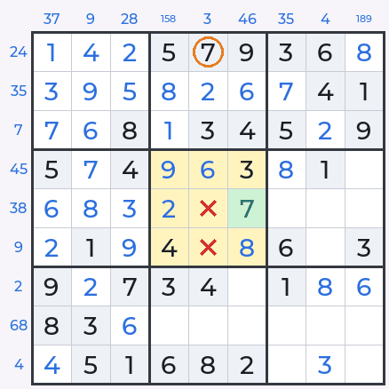

<!-- Written by tools/walkthrough.py outside-sudoku: edit the script, not this page. -->
# Outside Sudoku, step 33: the 7 in box 5

**Step 33 of 49** · [← Step 32](step-32.md) · [All steps](../outside-sudoku.md#the-whole-puzzle-step-by-step) · [Step 34 →](step-34.md)

Box 5 needs a 7. r5c5 and r6c5: column 5 has one (r1c5). Only **r5c6** is left: **r5c6 = 7**.

**Step 33 of 49** · [← Step 32](step-32.md) · [All steps](../outside-sudoku.md#the-whole-puzzle-step-by-step) · [Step 34 →](step-34.md)
