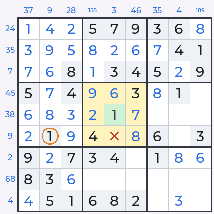

<!-- Written by tools/walkthrough.py outside-sudoku: edit the script, not this page. -->
# Outside Sudoku, step 34: the 1 in box 5

**Step 34 of 49** · [← Step 33](step-33.md) · [All steps](../outside-sudoku.md#the-whole-puzzle-step-by-step) · [Step 35 →](step-35.md)

Box 5 needs a 1. r6c5: row 6 has one (r6c2). Only **r5c5** is left: **r5c5 = 1**.

**Step 34 of 49** · [← Step 33](step-33.md) · [All steps](../outside-sudoku.md#the-whole-puzzle-step-by-step) · [Step 35 →](step-35.md)
