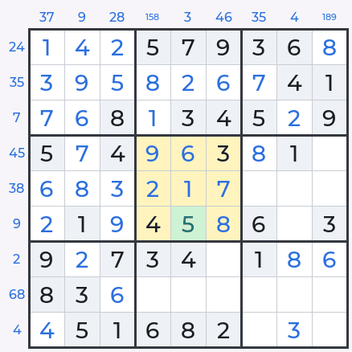

<!-- Written by tools/walkthrough.py outside-sudoku: edit the script, not this page. -->
# Outside Sudoku, step 35: the 5 in box 5

**Step 35 of 49** · [← Step 34](step-34.md) · [All steps](../outside-sudoku.md#the-whole-puzzle-step-by-step) · [Step 36 →](step-36.md)

Box 5 needs a 5, and r6c5 is its last empty cell: **r6c5 = 5**.

**Step 35 of 49** · [← Step 34](step-34.md) · [All steps](../outside-sudoku.md#the-whole-puzzle-step-by-step) · [Step 36 →](step-36.md)
