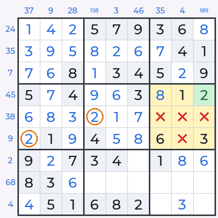

<!-- Written by tools/walkthrough.py outside-sudoku: edit the script, not this page. -->
# Outside Sudoku, step 36: the 2 in box 6

**Step 36 of 49** · [← Step 35](step-35.md) · [All steps](../outside-sudoku.md#the-whole-puzzle-step-by-step) · [Step 37 →](step-37.md)

Box 6 needs a 2. r5c7, r5c8 and r5c9: row 5 has one (r5c4). r6c8: row 6 has one (r6c1). Only **r4c9** is left: **r4c9 = 2**.

**Step 36 of 49** · [← Step 35](step-35.md) · [All steps](../outside-sudoku.md#the-whole-puzzle-step-by-step) · [Step 37 →](step-37.md)
