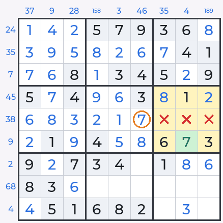

<!-- Written by tools/walkthrough.py outside-sudoku: edit the script, not this page. -->
# Outside Sudoku, step 37: the 7 in box 6

**Step 37 of 49** · [← Step 36](step-36.md) · [All steps](../outside-sudoku.md#the-whole-puzzle-step-by-step) · [Step 38 →](step-38.md)

Box 6 needs a 7. r5c7, r5c8 and r5c9: row 5 has one (r5c6). Only **r6c8** is left: **r6c8 = 7**.

**Step 37 of 49** · [← Step 36](step-36.md) · [All steps](../outside-sudoku.md#the-whole-puzzle-step-by-step) · [Step 38 →](step-38.md)
