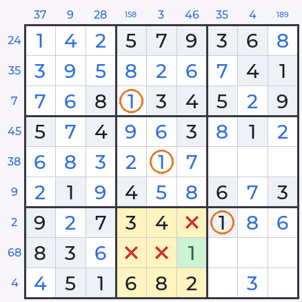

<!-- Written by tools/walkthrough.py outside-sudoku: edit the script, not this page. -->
# Outside Sudoku, step 38: the 1 in box 8

**Step 38 of 49** · [← Step 37](step-37.md) · [All steps](../outside-sudoku.md#the-whole-puzzle-step-by-step) · [Step 39 →](step-39.md)

Box 8 needs a 1. r7c6: row 7 has one (r7c7). r8c4: column 4 has one (r3c4). r8c5: column 5 has one (r5c5). Only **r8c6** is left: **r8c6 = 1**.

**Step 38 of 49** · [← Step 37](step-37.md) · [All steps](../outside-sudoku.md#the-whole-puzzle-step-by-step) · [Step 39 →](step-39.md)
