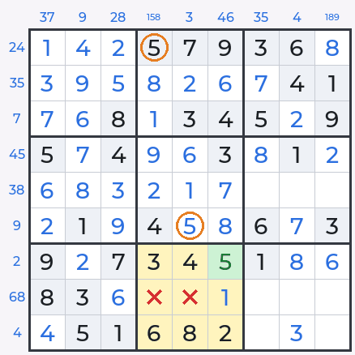

<!-- Written by tools/walkthrough.py outside-sudoku: edit the script, not this page. -->
# Outside Sudoku, step 39: the 5 in box 8

**Step 39 of 49** · [← Step 38](step-38.md) · [All steps](../outside-sudoku.md#the-whole-puzzle-step-by-step) · [Step 40 →](step-40.md)

Box 8 needs a 5. r8c4: column 4 has one (r1c4). r8c5: column 5 has one (r6c5). Only **r7c6** is left: **r7c6 = 5**.

**Step 39 of 49** · [← Step 38](step-38.md) · [All steps](../outside-sudoku.md#the-whole-puzzle-step-by-step) · [Step 40 →](step-40.md)
