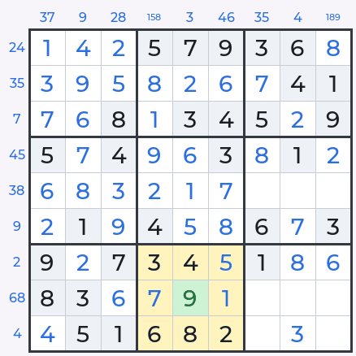

<!-- Written by tools/walkthrough.py outside-sudoku: edit the script, not this page. -->
# Outside Sudoku, step 41: the 9 in box 8

**Step 41 of 49** · [← Step 40](step-40.md) · [All steps](../outside-sudoku.md#the-whole-puzzle-step-by-step) · [Step 42 →](step-42.md)

Box 8 needs a 9, and r8c5 is its last empty cell: **r8c5 = 9**.

**Step 41 of 49** · [← Step 40](step-40.md) · [All steps](../outside-sudoku.md#the-whole-puzzle-step-by-step) · [Step 42 →](step-42.md)
