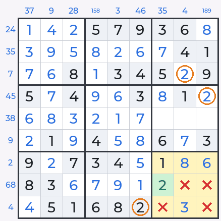

<!-- Written by tools/walkthrough.py outside-sudoku: edit the script, not this page. -->
# Outside Sudoku, step 42: the 2 in box 9

**Step 42 of 49** · [← Step 41](step-41.md) · [All steps](../outside-sudoku.md#the-whole-puzzle-step-by-step) · [Step 43 →](step-43.md)

Box 9 needs a 2. r8c8: column 8 has one (r3c8). r8c9: column 9 has one (r4c9). r9c7 and r9c9: row 9 has one (r9c6). Only **r8c7** is left: **r8c7 = 2**.

**Step 42 of 49** · [← Step 41](step-41.md) · [All steps](../outside-sudoku.md#the-whole-puzzle-step-by-step) · [Step 43 →](step-43.md)
