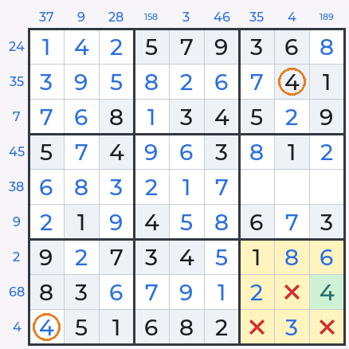

<!-- Written by tools/walkthrough.py outside-sudoku: edit the script, not this page. -->
# Outside Sudoku, step 43: the 4 in box 9

**Step 43 of 49** · [← Step 42](step-42.md) · [All steps](../outside-sudoku.md#the-whole-puzzle-step-by-step) · [Step 44 →](step-44.md)

Box 9 needs a 4. r8c8: column 8 has one (r2c8). r9c7 and r9c9: row 9 has one (r9c1). Only **r8c9** is left: **r8c9 = 4**.

**Step 43 of 49** · [← Step 42](step-42.md) · [All steps](../outside-sudoku.md#the-whole-puzzle-step-by-step) · [Step 44 →](step-44.md)
