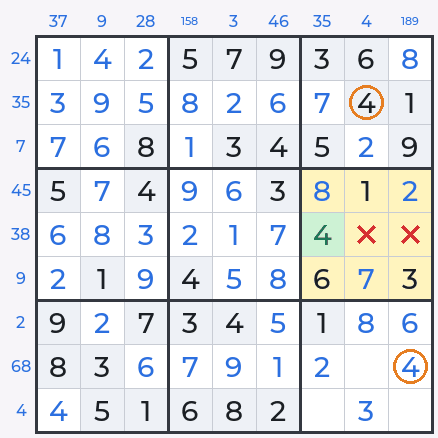

<!-- Written by tools/walkthrough.py outside-sudoku: edit the script, not this page. -->
# Outside Sudoku, step 44: the 4 in box 6

**Step 44 of 49** · [← Step 43](step-43.md) · [All steps](../outside-sudoku.md#the-whole-puzzle-step-by-step) · [Step 45 →](step-45.md)

Box 6 needs a 4. r5c8: column 8 has one (r2c8). r5c9: column 9 has one (r8c9). Only **r5c7** is left: **r5c7 = 4**.

**Step 44 of 49** · [← Step 43](step-43.md) · [All steps](../outside-sudoku.md#the-whole-puzzle-step-by-step) · [Step 45 →](step-45.md)
