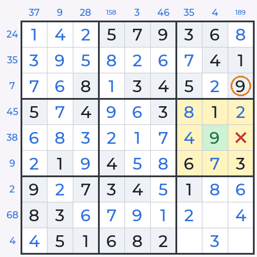

<!-- Written by tools/walkthrough.py outside-sudoku: edit the script, not this page. -->
# Outside Sudoku, step 45: the 9 in box 6

**Step 45 of 49** · [← Step 44](step-44.md) · [All steps](../outside-sudoku.md#the-whole-puzzle-step-by-step) · [Step 46 →](step-46.md)

Box 6 needs a 9. r5c9: column 9 has one (r3c9). Only **r5c8** is left: **r5c8 = 9**.

**Step 45 of 49** · [← Step 44](step-44.md) · [All steps](../outside-sudoku.md#the-whole-puzzle-step-by-step) · [Step 46 →](step-46.md)
