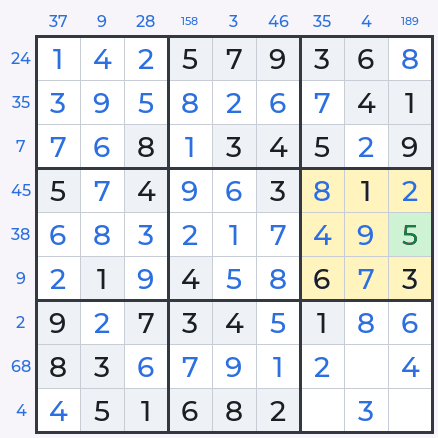

<!-- Written by tools/walkthrough.py outside-sudoku: edit the script, not this page. -->
# Outside Sudoku, step 46: the 5 in box 6

**Step 46 of 49** · [← Step 45](step-45.md) · [All steps](../outside-sudoku.md#the-whole-puzzle-step-by-step) · [Step 47 →](step-47.md)

Box 6 needs a 5, and r5c9 is its last empty cell: **r5c9 = 5**.

**Step 46 of 49** · [← Step 45](step-45.md) · [All steps](../outside-sudoku.md#the-whole-puzzle-step-by-step) · [Step 47 →](step-47.md)
