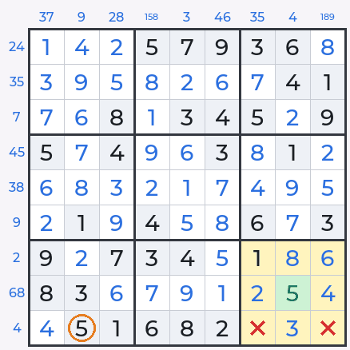

<!-- Written by tools/walkthrough.py outside-sudoku: edit the script, not this page. -->
# Outside Sudoku, step 47: the 5 in box 9

**Step 47 of 49** · [← Step 46](step-46.md) · [All steps](../outside-sudoku.md#the-whole-puzzle-step-by-step) · [Step 48 →](step-48.md)

Box 9 needs a 5. r9c7 and r9c9: row 9 has one (r9c2). Only **r8c8** is left: **r8c8 = 5**.

**Step 47 of 49** · [← Step 46](step-46.md) · [All steps](../outside-sudoku.md#the-whole-puzzle-step-by-step) · [Step 48 →](step-48.md)
