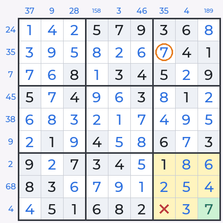

<!-- Written by tools/walkthrough.py outside-sudoku: edit the script, not this page. -->
# Outside Sudoku, step 48: the 7 in box 9

**Step 48 of 49** · [← Step 47](step-47.md) · [All steps](../outside-sudoku.md#the-whole-puzzle-step-by-step) · [Step 49 →](step-49.md)

Box 9 needs a 7. r9c7: column 7 has one (r2c7). Only **r9c9** is left: **r9c9 = 7**.

**Step 48 of 49** · [← Step 47](step-47.md) · [All steps](../outside-sudoku.md#the-whole-puzzle-step-by-step) · [Step 49 →](step-49.md)
