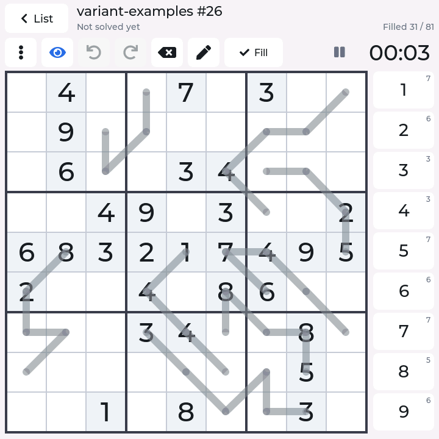

# Palindrome

[← All variants](README.md) · [Puzzles](../features-puzzles.md) · [How to play](../how-to-play.md)

## The rules

[Classic](classic.md) rules, plus **grey lines** through cells side by side or diagonal. Each line **reads the same from both ends**: its first and last cells hold the same digit, so do its second and second to last, and so on. A line of five could hold 3, 7, 5, 7, 3; the middle cell of an odd line is free.

Two cells that mirror each other hold the same digit, so they never share a row, column or box: a line always bends or crosses boxes to get there.

## On the board

- Each line is a translucent grey band under the digits.
- Two mirrored cells holding different digits turn red.
- The grader and hints copy a digit, or the candidates, from a cell to the one mirroring it: "This line reads the same from both ends, so row 6, column 8 can only be 7".
- **Puzzles → ⋮ → New puzzle → Palindrome**: 8 lines (Hard and Expert 10) of 3 to 7 cells.

## How to solve it

- **A digit on a line gives you its mirror:** fill it in at once.
- **Mirrored cells share their candidates:** what one cell can't be, the other can't be either. A digit ruled out by one cell's row is ruled out of its mirror too.
- **Mirrored cells see different rows, columns and boxes,** so together they rule a digit out of far more cells than one would.

## Worked example

**variant-examples #26**, Palindrome Easy (see [Classic](classic.md#worked-example-the-whole-puzzle) for how to import the examples; cells are written r*row*c*column*). The lines are in the picture; three matter here:

- a line of **five**: r6c7 (a 6), r5c6 (a 7), r5c7 (a 4), r6c8 and r7c9;
- a line of **four**: r3c7, r3c8, r4c9 (a 2) and r5c9 (a 5);
- another line of **five**: r5c2 (an 8), r6c1 (a 2), r7c1, r7c2 and r8c1.

**Step 1: r6c8, on the first line of five.** Row 6 has 2, 4, 6 and 8; column 8 has 3, 5, 8 and 9. By the Classic rules r6c8 could be 1 or 7. It is the line's fourth cell, mirroring its second, r5c6, a 7. **r6c8 = 7**, and r7c9 will be a 6 like the line's first cell.

**Step 2: r3c8, on the line of four.** Row 3 has 3, 4 and 6; column 8 has 5, 7 (step 1), 8 and 9; that leaves 1 and 2. It is the line's second cell, mirroring its third, r4c9, a 2. **r3c8 = 2**.

**Step 3: r7c2, on the other line of five.** Row 7 has 3, 4 and 8; column 2 has 6 and 9; box 7 has a 1; that leaves 2, 5 and 7. It mirrors r6c1, a 2. **r7c2 = 2**.

## The whole puzzle, step by step

<!-- walkthrough -->
<!-- Written by tools/walkthrough.py palindrome: edit the script, not this part. -->

The whole puzzle, from the start to the last cell: 50 steps, each one a single (one place left for a digit, or one digit left for a cell), taken in the order a box's single comes first, so not quite the order of the worked example above. Each step has a page of its own, with **Previous** and **Next**: pick one from the list below. In each picture, the unit the step looks at is tinted yellow (for a cell with one digit left: its row, column and box), the new digit is on green, the digits that rule cells out have an **orange ring**, and the empty cells they rule out a **red cross**. Givens are on grey, digits from earlier steps in blue.

1. [the 3 in box 1](palindrome/step-01.md)
2. [the 9 in box 2](palindrome/step-02.md)
3. [the 9 in box 3](palindrome/step-03.md)
4. [the 9 in box 4](palindrome/step-04.md)
5. [the 6 in box 5](palindrome/step-05.md)
6. [the 5 in box 5](palindrome/step-06.md)
7. [the 3 in box 6](palindrome/step-07.md)
8. [the 8 in box 6](palindrome/step-08.md)
9. [the 1 in box 6](palindrome/step-09.md)
10. [the 1 in box 4](palindrome/step-10.md)
11. [the 7 in box 6](palindrome/step-11.md)
12. [the 3 in box 7](palindrome/step-12.md)
13. [the 4 in box 7](palindrome/step-13.md)
14. [the 9 in box 7](palindrome/step-14.md)
15. [the 9 in box 8](palindrome/step-15.md)
16. [the 2 in box 8](palindrome/step-16.md)
17. [the 2 in box 2](palindrome/step-17.md)
18. [the 4 in box 9](palindrome/step-18.md)
19. [the 4 in box 3](palindrome/step-19.md)
20. [the 1 in box 9](palindrome/step-20.md)
21. [the 1 in box 3](palindrome/step-21.md)
22. [the 6 in box 3](palindrome/step-22.md)
23. [the 2 in box 3](palindrome/step-23.md)
24. [the 2 in box 1](palindrome/step-24.md)
25. [the 7 in box 3](palindrome/step-25.md)
26. [the 5 in box 3](palindrome/step-26.md)
27. [the 8 in box 3](palindrome/step-27.md)
28. [the 2 in box 7](palindrome/step-28.md)
29. [the 2 in box 9](palindrome/step-29.md)
30. [the 7 in box 9](palindrome/step-30.md)
31. [the 7 in box 8](palindrome/step-31.md)
32. [the 7 in box 7](palindrome/step-32.md)
33. [the 7 in box 1](palindrome/step-33.md)
34. [the 1 in box 1](palindrome/step-34.md)
35. [the 5 in box 1](palindrome/step-35.md)
36. [the 8 in box 1](palindrome/step-36.md)
37. [the 1 in box 2](palindrome/step-37.md)
38. [the 5 in box 2](palindrome/step-38.md)
39. [the 6 in box 2](palindrome/step-39.md)
40. [the 8 in box 2](palindrome/step-40.md)
41. [the 7 in box 4](palindrome/step-41.md)
42. [the 5 in box 4](palindrome/step-42.md)
43. [the 5 in box 7](palindrome/step-43.md)
44. [the 6 in box 7](palindrome/step-44.md)
45. [the 8 in box 7](palindrome/step-45.md)
46. [the 1 in box 8](palindrome/step-46.md)
47. [the 5 in box 8](palindrome/step-47.md)
48. [the 6 in box 8](palindrome/step-48.md)
49. [the 6 in box 9](palindrome/step-49.md)
50. [the 9 in box 9](palindrome/step-50.md)

Solved.

<!-- /walkthrough -->
