# Palindrome

[← All variants](README.md) · [Puzzles](../features-puzzles.md) · [How to play](../how-to-play.md)

## The rules

[Classic](classic.md) rules, plus **grey lines** through cells side by side or diagonal. Each line **reads the same from both ends**: its first and last cells hold the same digit, so do its second and second to last, and so on. A line of five could hold 3, 7, 5, 7, 3; the middle cell of an odd line is free.

Two cells that mirror each other hold the same digit, so they never share a row, column or box: a line always bends or crosses boxes to get there.

## On the board

- Each line is a translucent grey band under the digits.
- Two mirrored cells holding different digits turn red.
- The grader and hints copy a digit, or the candidates, from a cell to the one mirroring it: "This line reads the same from both ends, so row 6, column 8 can only be 7".
- **Puzzles → ⋮ → New puzzle → Palindrome**: 8 lines (Hard and Expert 10) of 3 to 7 cells.

## How to solve it

- **A digit on a line gives you its mirror:** fill it in at once.
- **Mirrored cells share their candidates:** what one cell can't be, the other can't be either. A digit ruled out by one cell's row is ruled out of its mirror too.
- **Mirrored cells see different rows, columns and boxes,** so together they rule a digit out of far more cells than one would.

## Worked example

**variant-examples #26**, Palindrome Easy (see [Classic](classic.md#worked-example-the-whole-puzzle) for how to import the examples; cells are written r*row*c*column*). The lines are in the picture; three matter here:

- a line of **five**: r6c7 (a 6), r5c6 (a 7), r5c7 (a 4), r6c8 and r7c9;
- a line of **four**: r3c7, r3c8, r4c9 (a 2) and r5c9 (a 5);
- another line of **five**: r5c2 (an 8), r6c1 (a 2), r7c1, r7c2 and r8c1.

**Step 1: r6c8, on the first line of five.** Row 6 has 2, 4, 6 and 8; column 8 has 3, 5, 8 and 9. By the Classic rules r6c8 could be 1 or 7. It is the line's fourth cell, mirroring its second, r5c6, a 7. **r6c8 = 7**, and r7c9 will be a 6 like the line's first cell.

**Step 2: r3c8, on the line of four.** Row 3 has 3, 4 and 6; column 8 has 5, 7 (step 1), 8 and 9; that leaves 1 and 2. It is the line's second cell, mirroring its third, r4c9, a 2. **r3c8 = 2**.

**Step 3: r7c2, on the other line of five.** Row 7 has 3, 4 and 8; column 2 has 6 and 9; box 7 has a 1; that leaves 2, 5 and 7. It mirrors r6c1, a 2. **r7c2 = 2**.

## The whole puzzle, step by step

<!-- walkthrough -->
<!-- Written by tools/walkthrough.py palindrome: edit the script, not this part. -->

The whole puzzle, from the start to the last cell: 50 steps, each one a single (one place left for a digit, or one digit left for a cell), taken in the order a box's single comes first, so not quite the order of the worked example above. In each picture, the unit the step looks at is tinted yellow (for a cell with one digit left: its row, column and box), the new digit is on green, the digits that rule cells out have an **orange ring**, and the empty cells they rule out a **red cross**. Givens are on grey, digits from earlier steps in blue.

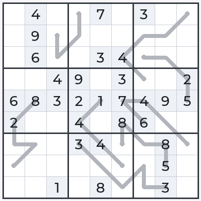

#### Step 1: the 3 in box 1

Box 1 needs a 3. r1c1 and r1c3: row 1 has one (r1c7). r2c3: column 3 has one (r5c3). r3c1 and r3c3: row 3 has one (r3c5). Only **r2c1** is left: **r2c1 = 3**.

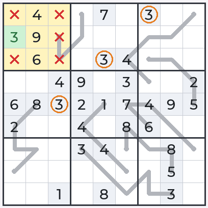

#### Step 2: the 9 in box 2

Box 2 needs a 9. r1c4 and r3c4: column 4 has one (r4c4). r2c4, r2c5 and r2c6: row 2 has one (r2c2). Only **r1c6** is left: **r1c6 = 9**.

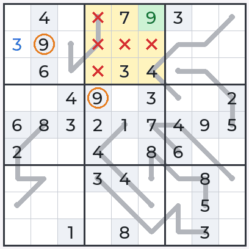

#### Step 3: the 9 in box 3

Box 3 needs a 9. r1c8 and r1c9: row 1 has one (r1c6). r2c7, r2c8 and r2c9: row 2 has one (r2c2). r3c8: column 8 has one (r5c8). r3c7: it mirrors the 5 in r5c9 on its grey line, which reads the same from both ends. Only **r3c9** is left: **r3c9 = 9**.

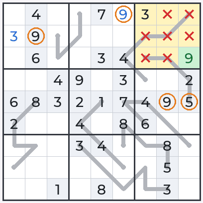

#### Step 4: the 9 in box 4

Box 4 needs a 9. r4c1 and r4c2: row 4 has one (r4c4). r6c2: column 2 has one (r2c2). Only **r6c3** is left: **r6c3 = 9**.

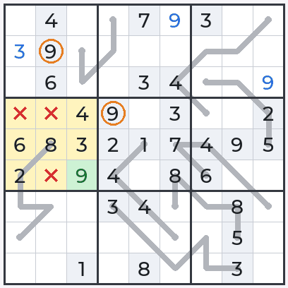

#### Step 5: the 6 in box 5

Box 5 needs a 6. r6c5: row 6 has one (r6c7). Only **r4c5** is left: **r4c5 = 6**.

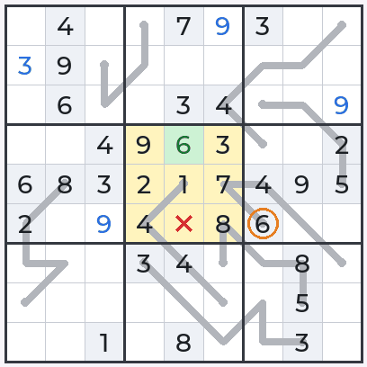

#### Step 6: the 5 in box 5

Box 5 needs a 5, and r6c5 is its last empty cell: **r6c5 = 5**.

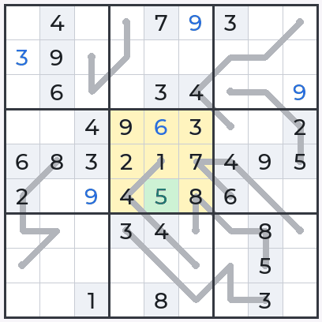

#### Step 7: the 3 in box 6

Box 6 needs a 3. r4c7 and r4c8: row 4 has one (r4c6). r6c8: column 8 has one (r9c8). Only **r6c9** is left: **r6c9 = 3**.

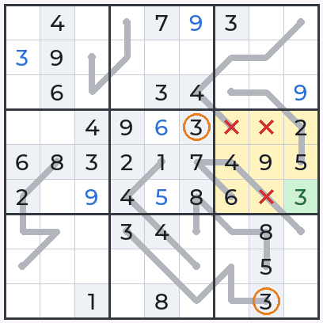

#### Step 8: the 8 in box 6

Box 6 needs an 8. r4c8: column 8 has one (r7c8). r6c8: row 6 has one (r6c6). Only **r4c7** is left: **r4c7 = 8**.

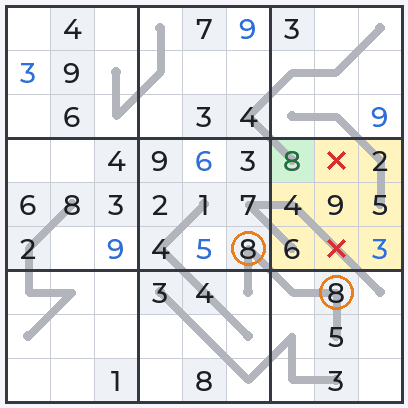

#### Step 9: the 1 in box 6

Box 6 needs a 1. r6c8: it mirrors the 7 in r5c6 on its grey line, which reads the same from both ends. Only **r4c8** is left: **r4c8 = 1**.

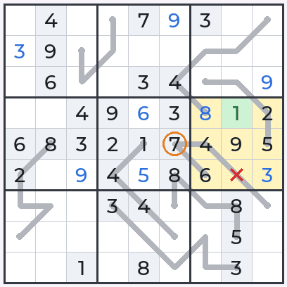

#### Step 10: the 1 in box 4

Box 4 needs a 1. r4c1 and r4c2: row 4 has one (r4c8). Only **r6c2** is left: **r6c2 = 1**.

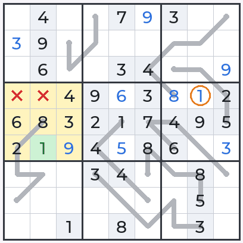

#### Step 11: the 7 in box 6

Box 6 needs a 7, and r6c8 is its last empty cell: **r6c8 = 7**.

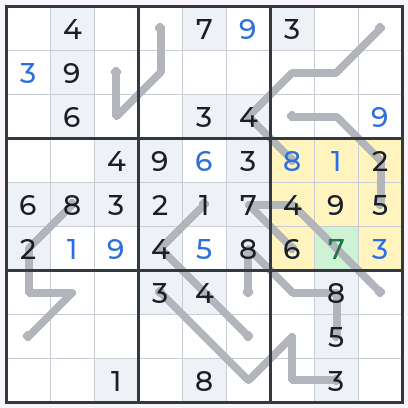

#### Step 12: the 3 in box 7

Box 7 needs a 3. r7c1, r7c2 and r7c3: row 7 has one (r7c4). r8c1: column 1 has one (r2c1). r8c3: column 3 has one (r5c3). r9c1 and r9c2: row 9 has one (r9c8). Only **r8c2** is left: **r8c2 = 3**.

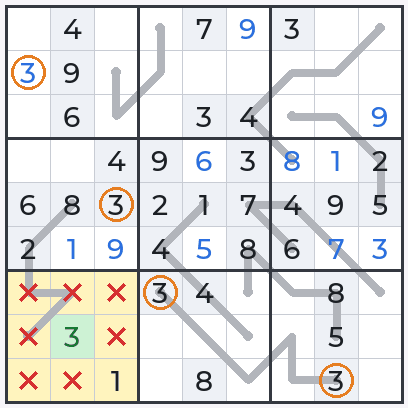

#### Step 13: the 4 in box 7

Box 7 needs a 4. r7c1, r7c2 and r7c3: row 7 has one (r7c5). r8c3: column 3 has one (r4c3). r9c2: column 2 has one (r1c2). r8c1: it mirrors the 8 in r5c2 on its grey line, which reads the same from both ends. Only **r9c1** is left: **r9c1 = 4**.

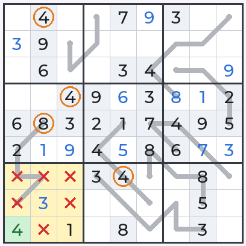

#### Step 14: the 9 in box 7

Box 7 needs a 9. r7c2 and r9c2: column 2 has one (r2c2). r7c3 and r8c3: column 3 has one (r6c3). r8c1: it mirrors the 8 in r5c2 on its grey line, which reads the same from both ends. Only **r7c1** is left: **r7c1 = 9**.

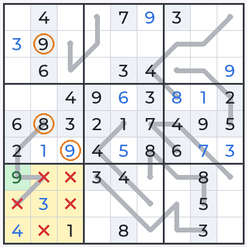

#### Step 15: the 9 in box 8

Box 8 needs a 9. r7c6: row 7 has one (r7c1). r8c4 and r9c4: column 4 has one (r4c4). r8c6 and r9c6: column 6 has one (r1c6). Only **r8c5** is left: **r8c5 = 9**.

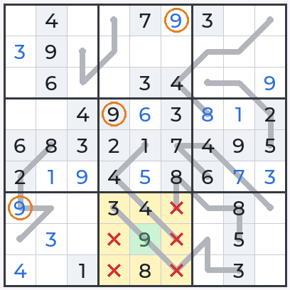

#### Step 16: the 2 in box 8

Box 8 needs a 2. r8c4 and r9c4: column 4 has one (r5c4). r7c6: it mirrors the 5 in r8c8 on its grey line, which reads the same from both ends. r8c6: it mirrors the 1 in r5c5 on its grey line, which reads the same from both ends. Only **r9c6** is left: **r9c6 = 2**.

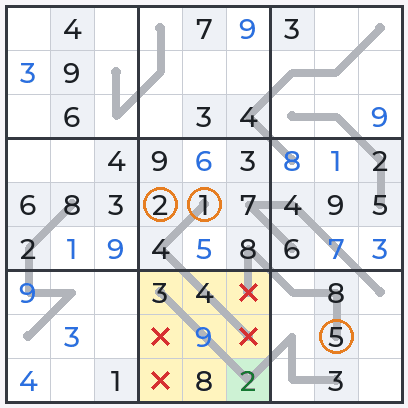

#### Step 17: the 2 in box 2

Box 2 needs a 2. r1c4, r2c4 and r3c4: column 4 has one (r5c4). r2c6: column 6 has one (r9c6). Only **r2c5** is left: **r2c5 = 2**.

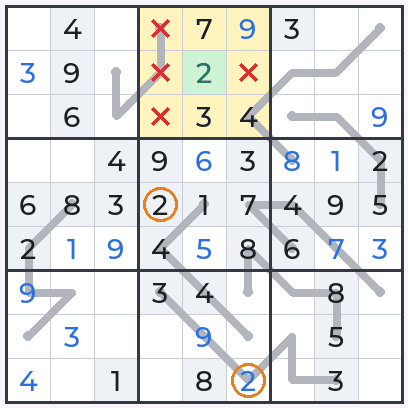

#### Step 18: the 4 in box 9

Box 9 needs a 4. r7c7 and r7c9: row 7 has one (r7c5). r8c7: column 7 has one (r5c7). r9c7 and r9c9: row 9 has one (r9c1). Only **r8c9** is left: **r8c9 = 4**.

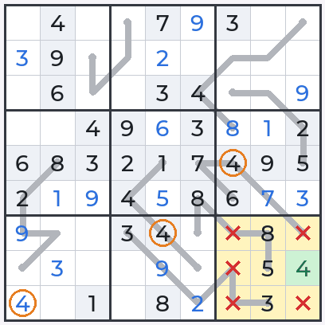

#### Step 19: the 4 in box 3

Box 3 needs a 4. r1c8 and r1c9: row 1 has one (r1c2). r2c7: column 7 has one (r5c7). r2c9: column 9 has one (r8c9). r3c7 and r3c8: row 3 has one (r3c6). Only **r2c8** is left: **r2c8 = 4**.

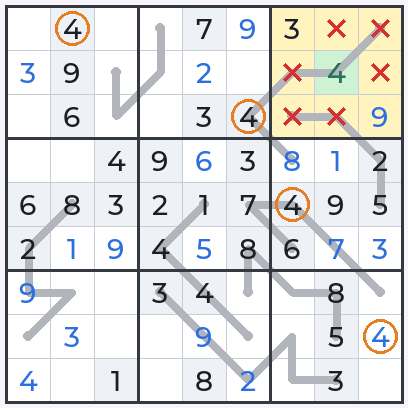

#### Step 20: the 1 in box 9

Box 9 needs a 1. r9c7 and r9c9: row 9 has one (r9c3). r7c9: it mirrors the 6 in r6c7 on its grey line, which reads the same from both ends. r8c7: it mirrors the 2 in r9c6 on its grey line, which reads the same from both ends. Only **r7c7** is left: **r7c7 = 1**.

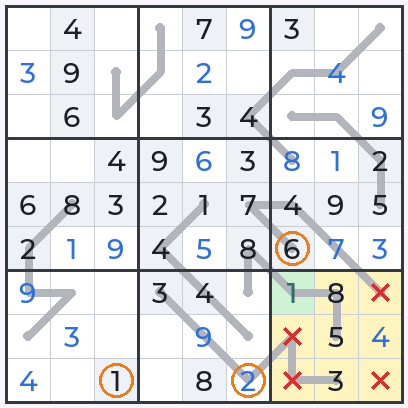

#### Step 21: the 1 in box 3

Box 3 needs a 1. r1c8 and r3c8: column 8 has one (r4c8). r2c7 and r3c7: column 7 has one (r7c7). r1c9: it mirrors the 8 in r4c7 on its grey line, which reads the same from both ends. Only **r2c9** is left: **r2c9 = 1**.

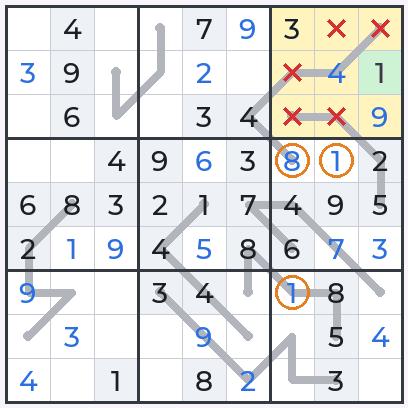

#### Step 22: the 6 in box 3

Box 3 needs a 6. r2c7: column 7 has one (r6c7). r3c7 and r3c8: row 3 has one (r3c2). r1c9: it mirrors the 8 in r4c7 on its grey line, which reads the same from both ends. Only **r1c8** is left: **r1c8 = 6**.

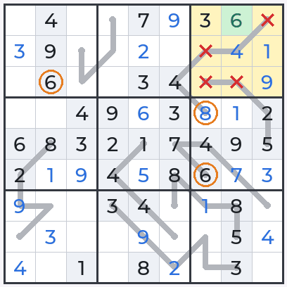

#### Step 23: the 2 in box 3

Box 3 needs a 2. r1c9: column 9 has one (r4c9). r2c7: row 2 has one (r2c5). r3c7: it mirrors the 5 in r5c9 on its grey line, which reads the same from both ends. Only **r3c8** is left: **r3c8 = 2**.

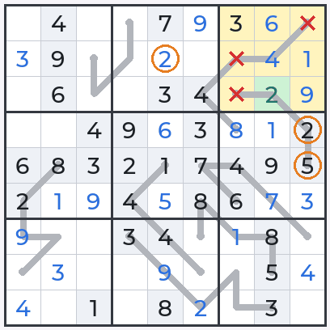

#### Step 24: the 2 in box 1

Box 1 needs a 2. r1c1: column 1 has one (r6c1). r2c3: row 2 has one (r2c5). r3c1 and r3c3: row 3 has one (r3c8). Only **r1c3** is left: **r1c3 = 2**.

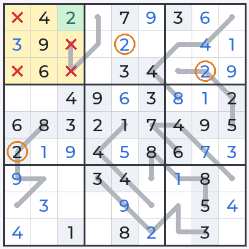

#### Step 25: the 7 in box 3

Box 3 needs a 7. r1c9: row 1 has one (r1c5). r3c7: it mirrors the 5 in r5c9 on its grey line, which reads the same from both ends. Only **r2c7** is left: **r2c7 = 7**.

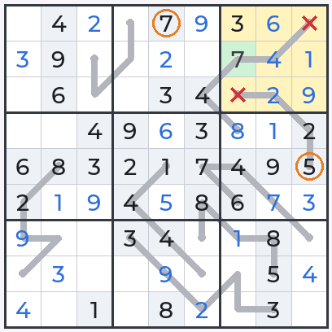

#### Step 26: the 5 in box 3

Box 3 needs a 5. r1c9: column 9 has one (r5c9). Only **r3c7** is left: **r3c7 = 5**.

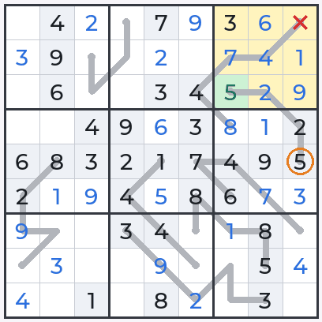

#### Step 27: the 8 in box 3

Box 3 needs an 8, and r1c9 is its last empty cell: **r1c9 = 8**.

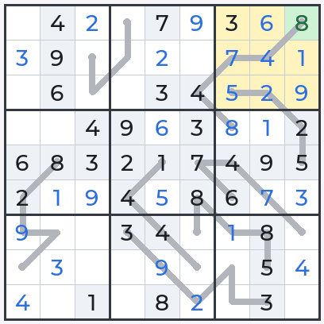

#### Step 28: the 2 in box 7

Box 7 needs a 2. r7c3 and r8c3: column 3 has one (r1c3). r8c1: column 1 has one (r6c1). r9c2: row 9 has one (r9c6). Only **r7c2** is left: **r7c2 = 2**.

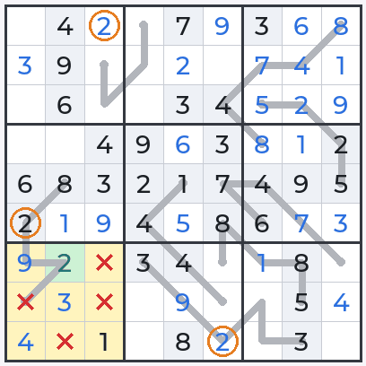

#### Step 29: the 2 in box 9

Box 9 needs a 2. r7c9: row 7 has one (r7c2). r9c7 and r9c9: row 9 has one (r9c6). Only **r8c7** is left: **r8c7 = 2**.

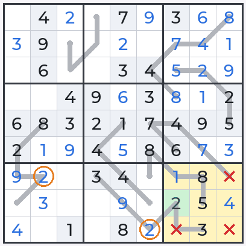

#### Step 30: the 7 in box 9

Box 9 needs a 7. r9c7: column 7 has one (r2c7). r7c9: it mirrors the 6 in r6c7 on its grey line, which reads the same from both ends. Only **r9c9** is left: **r9c9 = 7**.

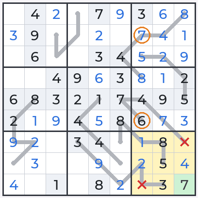

#### Step 31: the 7 in box 8

Box 8 needs a 7. r7c6 and r8c6: column 6 has one (r5c6). r9c4: row 9 has one (r9c9). Only **r8c4** is left: **r8c4 = 7**.

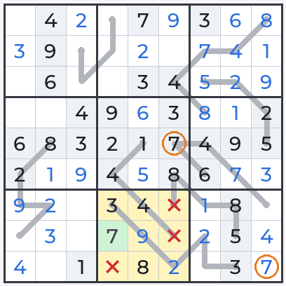

#### Step 32: the 7 in box 7

Box 7 needs a 7. r8c1 and r8c3: row 8 has one (r8c4). r9c2: row 9 has one (r9c9). Only **r7c3** is left: **r7c3 = 7**.

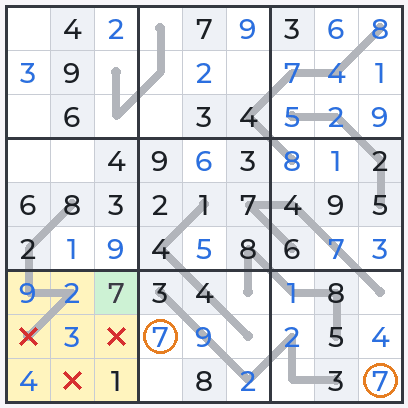

#### Step 33: the 7 in box 1

Box 1 needs a 7. r1c1: row 1 has one (r1c5). r2c3: row 2 has one (r2c7). r3c3: column 3 has one (r7c3). Only **r3c1** is left: **r3c1 = 7**.

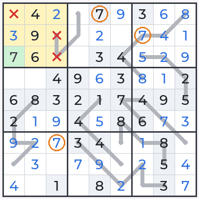

#### Step 34: the 1 in box 1

Box 1 needs a 1. r2c3: row 2 has one (r2c9). r3c3: column 3 has one (r9c3). Only **r1c1** is left: **r1c1 = 1**.

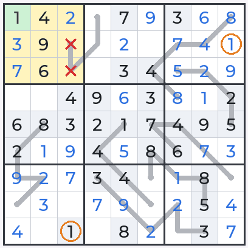

#### Step 35: the 5 in box 1

Box 1 needs a 5. r3c3: row 3 has one (r3c7). Only **r2c3** is left: **r2c3 = 5**.

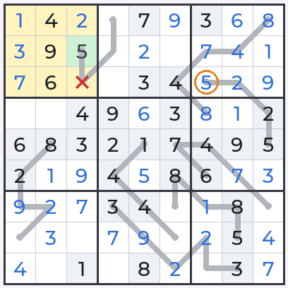

#### Step 36: the 8 in box 1

Box 1 needs an 8, and r3c3 is its last empty cell: **r3c3 = 8**.

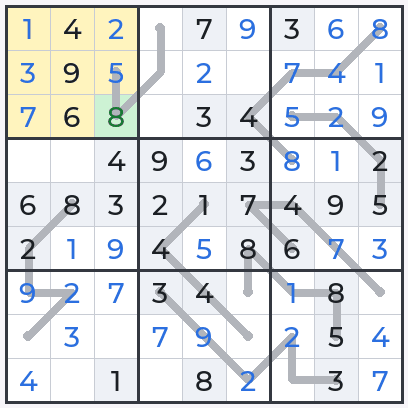

#### Step 37: the 1 in box 2

Box 2 needs a 1. r1c4: row 1 has one (r1c1). r2c4 and r2c6: row 2 has one (r2c9). Only **r3c4** is left: **r3c4 = 1**.

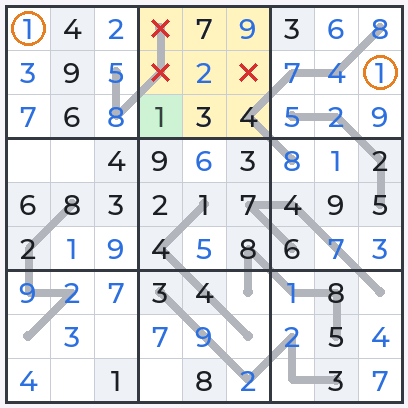

#### Step 38: the 5 in box 2

Box 2 needs a 5. r2c4 and r2c6: row 2 has one (r2c3). Only **r1c4** is left: **r1c4 = 5**.

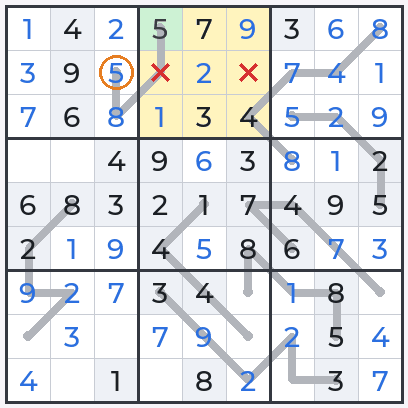

#### Step 39: the 6 in box 2

Box 2 needs a 6. r2c4: it mirrors the 8 in r3c3 on its grey line, which reads the same from both ends. Only **r2c6** is left: **r2c6 = 6**.

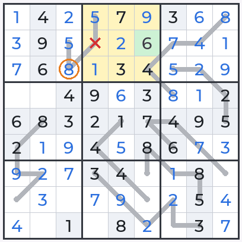

#### Step 40: the 8 in box 2

Box 2 needs an 8, and r2c4 is its last empty cell: **r2c4 = 8**.

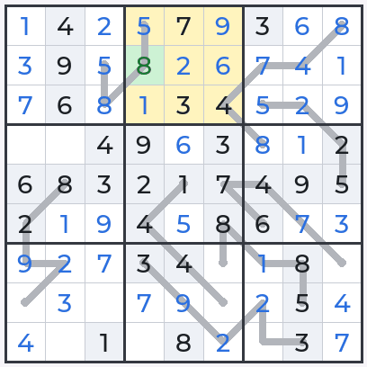

#### Step 41: the 7 in box 4

Box 4 needs a 7. r4c1: column 1 has one (r3c1). Only **r4c2** is left: **r4c2 = 7**.

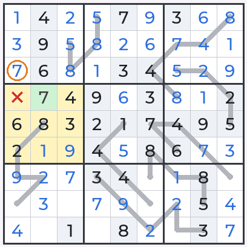

#### Step 42: the 5 in box 4

Box 4 needs a 5, and r4c1 is its last empty cell: **r4c1 = 5**.

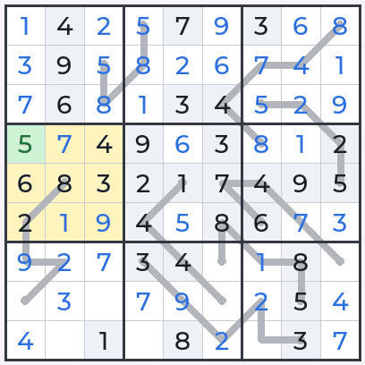

#### Step 43: the 5 in box 7

Box 7 needs a 5. r8c1 and r8c3: row 8 has one (r8c8). Only **r9c2** is left: **r9c2 = 5**.

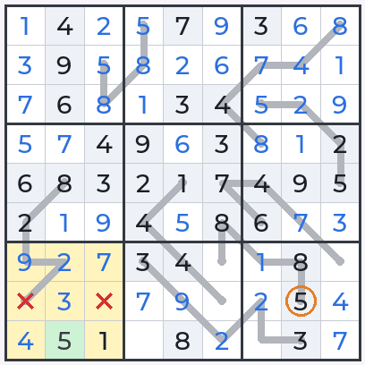

#### Step 44: the 6 in box 7

Box 7 needs a 6. r8c1: column 1 has one (r5c1). Only **r8c3** is left: **r8c3 = 6**.

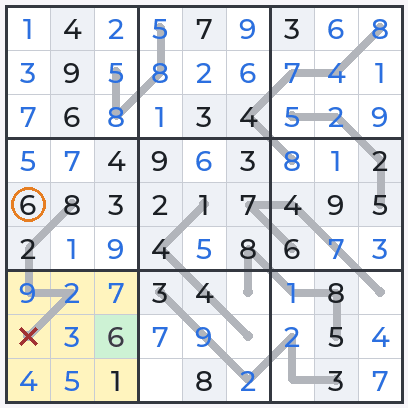

#### Step 45: the 8 in box 7

Box 7 needs an 8, and r8c1 is its last empty cell: **r8c1 = 8**.

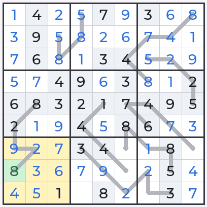

#### Step 46: the 1 in box 8

Box 8 needs a 1. r7c6: row 7 has one (r7c7). r9c4: row 9 has one (r9c3). Only **r8c6** is left: **r8c6 = 1**.

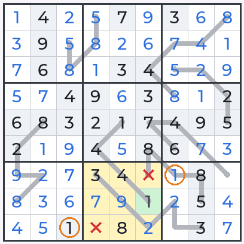

#### Step 47: the 5 in box 8

Box 8 needs a 5. r9c4: row 9 has one (r9c2). Only **r7c6** is left: **r7c6 = 5**.

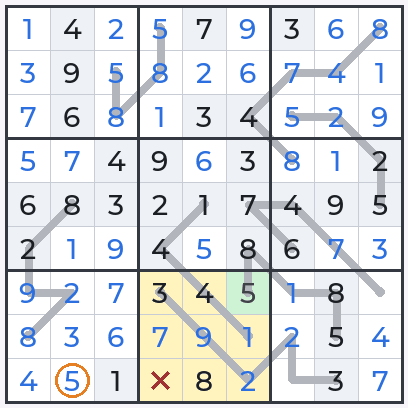

#### Step 48: the 6 in box 8

Box 8 needs a 6, and r9c4 is its last empty cell: **r9c4 = 6**.

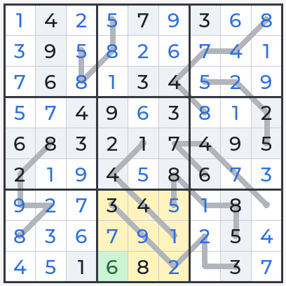

#### Step 49: the 6 in box 9

Box 9 needs a 6. r9c7: row 9 has one (r9c4). Only **r7c9** is left: **r7c9 = 6**.

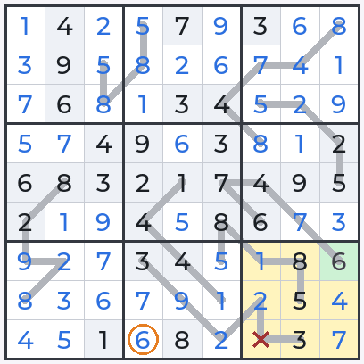

#### Step 50: the 9 in box 9

Box 9 needs a 9, and r9c7 is its last empty cell: **r9c7 = 9**.

Solved.

<!-- /walkthrough -->
