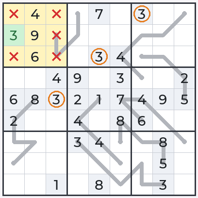

<!-- Written by tools/walkthrough.py palindrome: edit the script, not this page. -->
# Palindrome, step 1: the 3 in box 1

**Step 1 of 50** · [← The start](../palindrome.md#the-whole-puzzle-step-by-step) · [All steps](../palindrome.md#the-whole-puzzle-step-by-step) · [Step 2 →](step-02.md)

Box 1 needs a 3. r1c1 and r1c3: row 1 has one (r1c7). r2c3: column 3 has one (r5c3). r3c1 and r3c3: row 3 has one (r3c5). Only **r2c1** is left: **r2c1 = 3**.

**Step 1 of 50** · [← The start](../palindrome.md#the-whole-puzzle-step-by-step) · [All steps](../palindrome.md#the-whole-puzzle-step-by-step) · [Step 2 →](step-02.md)
