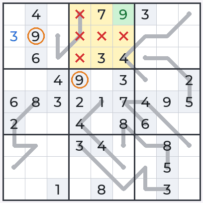

<!-- Written by tools/walkthrough.py palindrome: edit the script, not this page. -->
# Palindrome, step 2: the 9 in box 2

**Step 2 of 50** · [← Step 1](step-01.md) · [All steps](../palindrome.md#the-whole-puzzle-step-by-step) · [Step 3 →](step-03.md)

Box 2 needs a 9. r1c4 and r3c4: column 4 has one (r4c4). r2c4, r2c5 and r2c6: row 2 has one (r2c2). Only **r1c6** is left: **r1c6 = 9**.

**Step 2 of 50** · [← Step 1](step-01.md) · [All steps](../palindrome.md#the-whole-puzzle-step-by-step) · [Step 3 →](step-03.md)
