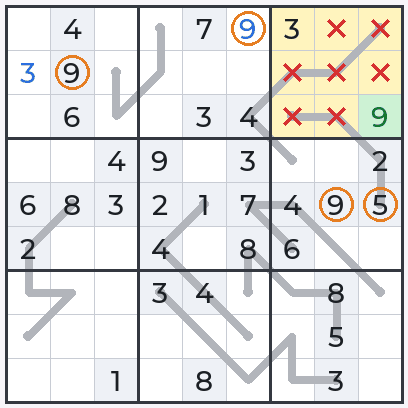

<!-- Written by tools/walkthrough.py palindrome: edit the script, not this page. -->
# Palindrome, step 3: the 9 in box 3

**Step 3 of 50** · [← Step 2](step-02.md) · [All steps](../palindrome.md#the-whole-puzzle-step-by-step) · [Step 4 →](step-04.md)

Box 3 needs a 9. r1c8 and r1c9: row 1 has one (r1c6). r2c7, r2c8 and r2c9: row 2 has one (r2c2). r3c8: column 8 has one (r5c8). r3c7: it mirrors the 5 in r5c9 on its grey line, which reads the same from both ends. Only **r3c9** is left: **r3c9 = 9**.

**Step 3 of 50** · [← Step 2](step-02.md) · [All steps](../palindrome.md#the-whole-puzzle-step-by-step) · [Step 4 →](step-04.md)
